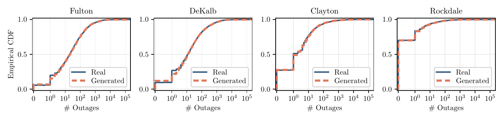
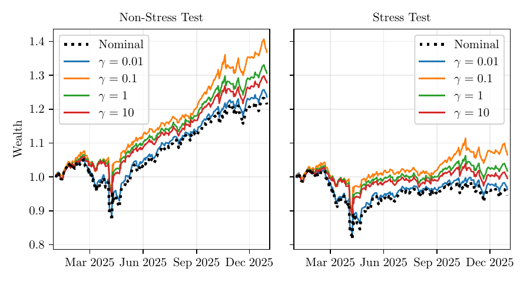

# Generative Models for Decision-Making under Distributional Shift

This repository contains companion code for the paper:

> [Generative models for decision-making under distributional shift](https://arxiv.org/abs/2604.04342).
>
> Xiuyuan Cheng, Yunqin Zhu, and Yao Xie. *INFORMS TutORials in Operations Research*, 2026.

The code was developed by Yunqin Zhu (yzhu812@gatech.edu).

Two standalone examples are included:

- `examples/outage`: county outage scenarios generated by a flow-matching model.
- `examples/portfolio`: distributionally robust portfolio optimization using return scenarios generated by a flow-matching model.

<p align="center">
  <br>
  <sub><em>Empirical and generated outage-count CDFs for four Atlanta-area counties, from the tutorial.</em></sub>
</p>

<p align="center">
  <br>
  <sub><em>Out-of-sample cumulative wealth of nominal and robust portfolios on test returns (left) and stress-test returns (right), from the tutorial.</em></sub>
</p>

## Setup

```bash
python -m venv .venv
source .venv/bin/activate
pip install -r requirements.txt
```

## Data

- Outage: county-level outage counts from [EAGLE-I](https://doi.org/10.6084/m9.figshare.24237376.v4), released by Brelsford et al. under [CC BY 4.0](https://creativecommons.org/licenses/by/4.0/). The tutorial used internal outage data; this example uses EAGLE-I for the same counties and period.
- Portfolio: adjusted daily closing prices from [Yahoo Finance](https://finance.yahoo.com/), downloaded with [yfinance](https://github.com/ranaroussi/yfinance). Daily returns are calculated from consecutive adjusted closing prices.

## Run

```bash
cd examples/outage
python download.py
python train.py
python plot.py

cd ../portfolio
python download.py
python train.py
python plot.py
```

The outage and portfolio examples take about 3.2 and 2.4 minutes on average on an Intel Xeon Platinum 8481C CPU using 2 threads. This includes plotting but not data downloads.

## Formulation

### Flow Matching Generative Models

Let $x_0 \in \mathbb R^d$ be a scaled data vector, $x_1 \sim \mathcal N(0,I)$, and $t \sim \mathrm{Unif}(0,1)$. Flow matching trains a vector field $v_\phi$ along the path $x_t = (1-t)x_0 + t x_1$:

```math
\min_\phi \; \mathbb E [\frac{1}{d}
\|v_\phi(x_t,t) - (x_1-x_0)\|_2^2
].
```

Synthetic scenarios are generated by explicit Euler integration from $t=1$ to $t=0$, starting from $x(1)\sim\mathcal N(0,I)$.

### Outage Example

Let $c_i \in \mathbb N_0^d$ be the numbers of customers without power in $d=10$ counties at timestamp $i$. We apply a log transform followed by countywise standardization:

```math
y_i = \log(1+c_i), \qquad
x_i = (y_i-\mu_y)\oslash \sigma_y,
```

where $\mu_y,\sigma_y\in\mathbb R^d$ are countywise training statistics, and $\oslash$ and $\odot$ denote elementwise division and multiplication. A generated sample $\hat x_i$ is mapped back to outage counts by

```math
\hat c_i = \mathrm{round}\!((\exp(\mu_y + \sigma_y\odot \hat x_i)-1)_+).
```

The joint representation allows the flow model to learn spatial dependence across counties. Evaluation compares county marginals and correlations, and computes MMD between real and generated outage counts after the log transformation. For real samples $a_1,\ldots,a_m$ and generated samples $b_1,\ldots,b_n$ used in the evaluation, define the RBF kernel

```math
k(a,b)=\exp\!(-\frac{\|a-b\|_2^2}{2h}),
```

where $h$ is the median positive squared distance between real samples $a'_1,\ldots,a'_p$:

```math
\ell^2=h,
\qquad
h=\mathrm{median}\{\|a'_i-a'_j\|_2^2:
1\le i<j\le p,\; \|a'_i-a'_j\|_2^2>0\}.
```

The empirical squared MMD is

```math
\widehat{\mathrm{MMD}}^2
=
\frac{1}{m^2}\sum_{i=1}^m\sum_{j=1}^m k(a_i,a_j)
+
\frac{1}{n^2}\sum_{i=1}^n\sum_{j=1}^n k(b_i,b_j)
-
\frac{2}{mn}\sum_{i=1}^m\sum_{j=1}^n k(a_i,b_j).
```

This is the biased empirical estimator including diagonal kernel terms.

### Portfolio Example

Let $r_i\in\mathbb R^d$, $i=1,\ldots,n$, be raw daily return vectors for $d=6$ assets, $R^{\mathrm{train}}$ the matrix with rows $r_i^\top$, and $\mu,\sigma\in\mathbb R^d$ the assetwise training means and standard deviations. Flow matching uses standardized inputs $y_i=(r_i-\mu)\oslash\sigma$. Generated samples $\hat y_i$ are mapped back to returns as $\hat r_i=\mu+\sigma\odot\hat y_i$. For portfolio optimization, define

```math
s = \frac{1}{nd}\sum_{i=1}^{n}\sum_{j=1}^d|R^{\mathrm{train}}_{ij}|,
\qquad x_i=\frac{r_i-\mu}{s}.
```

The generated nominal scenarios in this space are $\hat x_i=(\hat r_i-\mu)/s$. With portfolio weights $w=\mathrm{softmax}(\theta)\in\Delta_d$, target return $q$, smoothing parameter $\beta$, and $\bar q(w)=(q-\mu^\top w)/s$, the scaled softplus shortfall is

```math
\ell(x,w)
=
\frac{1}{\beta}
\log\!(1+\exp(\beta(\bar q(w)-x^\top w))).
```

The nominal portfolio solves

```math
\min_\theta \; \frac{1}{n}\sum_{i=1}^n \ell(\hat x_i,w(\theta)).
```

The robust portfolio allows scenarios to move toward higher loss, with $\gamma$ controlling the displacement penalty:

```math
\min_\theta \; \max_{z_1,\ldots,z_n}
\frac{1}{n}\sum_{i=1}^n
[
\ell(z_i,w(\theta))
-
\frac{1}{2\gamma}\|z_i-\hat x_i\|_2^2
].
```

Here $\hat x_i$ and $z_i$ are in the globally scaled return space, and worst-case raw returns are $r_i^{\mathrm{wc}}=\mu+s z_i$. Evaluation compares equal-weight, nominal, and robust portfolios on test returns $r_i^{\mathrm{test}}$ and stress returns $r_i^{\mathrm{stress}}=r_i^{\mathrm{test}}-0.001\mathbf 1$. We use the MMD formula above to compare historical and generated returns after assetwise standardization.

## Experiment Settings

Both examples use an MLP with 4 hidden layers of width 256, SiLU activations, and a 64-dimensional sinusoidal time embedding. Flow training uses AdamW with an initial learning rate of $10^{-3}$, cosine learning-rate decay, and weight decay of $10^{-5}$. Sampling uses 100 explicit Euler steps from $t=1$ to $t=0$.

Outage:

- Data: 245,472 observations of outage counts across 10 Atlanta-area counties, recorded at 15-minute intervals.
- Window: January 1, 2018, 00:00 to December 31, 2024, 23:45 UTC for both training and evaluation.
- Flow training and sampling: 100 epochs, batch size 1024; 4096 nominal samples.
- Evaluation: RBF MMD² on log-transformed outage counts; marginal distributions and county correlations.

Portfolio:

- Data: 752 daily return vectors for 6 ETFs, `SPY IWM EFA EEM AGG GLD`, calculated from adjusted closing prices.
- Window: 2023–2025; 502 training days in 2023–2024 and 250 test days in 2025.
- Flow training and sampling: 20000 epochs, batch size 502 (full batch); 502 nominal samples.
- Portfolio optimization: softplus shortfall with $q=0.02$ and $\beta=4$; equal-weight initialization; 100000 gradient descent steps for the nominal portfolio and 100000 gradient descent–ascent steps for each robust portfolio with $\gamma\in\{0.01,0.1,1,10\}$.
- Evaluation: RBF MMD² in the standardized return space; portfolio losses and return statistics on test and stress-test data.

## Code

Each example contains:

- `download.py`: download and prepare the data.
- `train.py`: load data, train the model, and save results.
- `plot.py`: generate figures from saved results.
- `src/data.py`: data loading and preprocessing.
- `src/flow.py`: flow model, Euler sampling, and MMD.
- `src/viz.py`: data and result visualization.

The portfolio example also has `src/dro.py` for portfolio optimization and evaluation.

## Outputs

Each example writes to its own `results/` directory:

- `config.json`: experiment settings and data statistics.
- `flow_loss.csv`: flow training loss.
- `metrics.csv`: evaluation metrics.
- `nominal.csv`: generated nominal scenarios.
- `figures/`: plots generated by `plot.py`.

The portfolio example also writes:

- `dro_loss.csv`: nominal and robust portfolio optimization histories.
- `weights.csv`: portfolio weights.
- `worst_case.csv`: worst-case returns labeled by $\gamma$.
